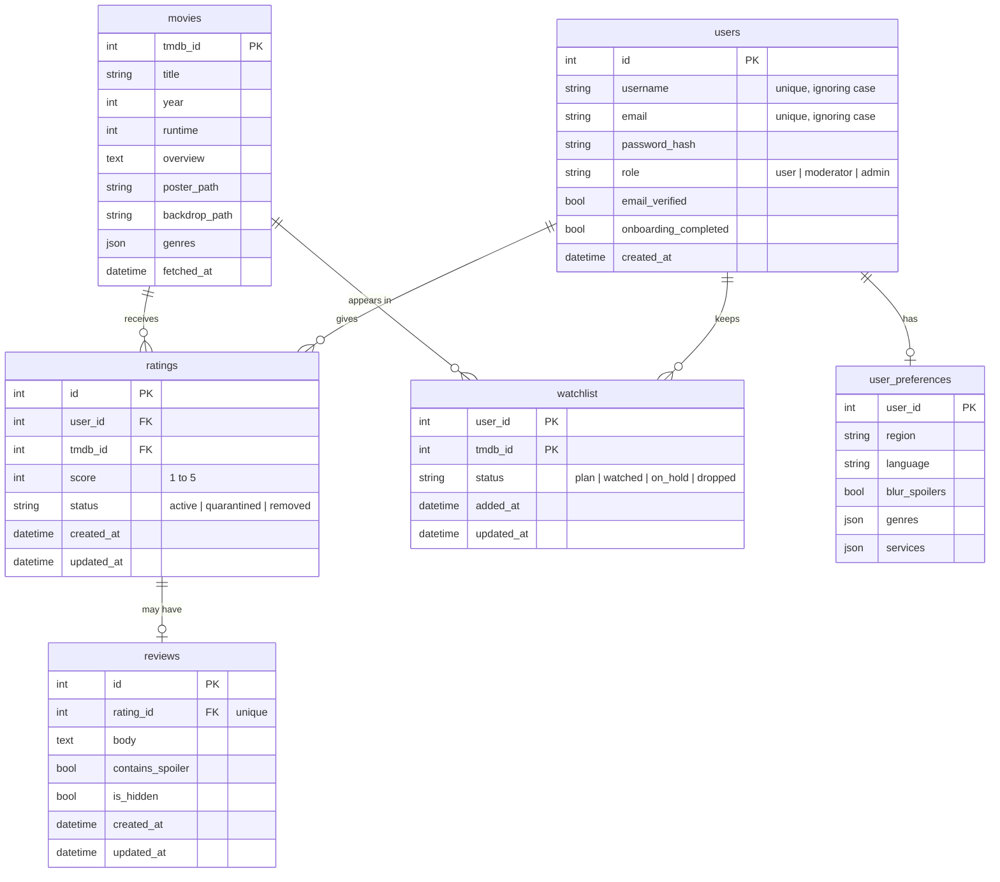

# Database schema

Tables created by the first migration. Other tables, such as `movie_stats` for the Bayesian ranking
and the backlog tables (review votes, reports), are added later by their owners with their own migrations.

## Rules the database enforces

| Rule | How |
|---|---|
| One rating per user per movie | unique `(user_id, tmdb_id)` on `ratings` |
| Score is 1 to 5 | check constraint on `ratings.score` |
| One review per rating, never blank | unique `rating_id`, check on `body` |
| One watchlist entry per user per movie | composite primary key `(user_id, tmdb_id)` |
| Status values are valid | check constraints on `role`, rating `status`, watchlist `status` |
| Same username or email in a different case is a duplicate | unique index on `lower(username)` and `lower(email)` |
| Deleting a user removes their ratings, reviews, watchlist, and preferences | `ON DELETE CASCADE` |
| A movie that has ratings or watchlist entries cannot be deleted | `ON DELETE RESTRICT` |

A movie must be saved in `movies` before anyone can rate it or add it to a watchlist. The rating and
watchlist endpoints should fetch it through the TMDB wrapper first.

## How the frontend's names map

| Frontend | Database |
|---|---|
| movie `id` | `movies.tmdb_id` |
| movie `synopsis` | `movies.overview` |
| watchlist `movieId`, `dateAdded` | `watchlist.tmdb_id`, `added_at` |
| user `emailVerified`, `onboardingCompleted` | `email_verified`, `onboarding_completed` (the API converts the names) |